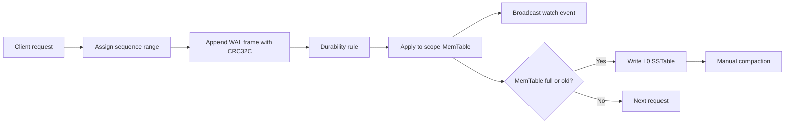

# StorKV

A scoped, crash-hardened MVCC key-value storage engine and server, written in Rust.

## Pronunciation

StorKV is pronounced `/ˈstɔːrkviː/` (_stork-vee_). Say `kv` as one sound. Do not say _stor-k-vee_.

StorKV runs in two forms:

- An embedded library (`storkv-core`) that opens a data directory in your process.
- A network daemon (`storkvd`) that serves the same engine over native, HTTP, WebSocket, gRPC, Redis, Memcached, and etcd interfaces.

Operational tools come with the workspace: `storkvctl` for health, integrity, backup, restore, migration, and benchmarks, and `storkv-top` for a live terminal dashboard.

## Features

- **Scopes.** Each scope has its own memtable, SSTable levels, durability mode, retention policy, and storage mode. All scopes share one WAL.
- **Storage modes.** Each scope can live on disk, in RAM only, or in RAM with a disk WAL and recovery snapshots. `Db::open_in_memory` opens a process-only database.
- **MVCC and OCC transactions.** Snapshot reads, optimistic commit validation, and explicit write conflicts.
- **Conditional writes.** `put_if` matches on absence, presence, sequence, or value in one round trip.
- **Merge operators.** Atomic counters, bounded appends, min and max, bitwise OR and AND, and custom operators.
- **Durable writes.** CRC32C-framed WAL with strict `fdatasync` or buffered group commit.
- **LSM storage.** Prefix-compressed SSTables with Bloom filters, LZ4 blocks, and a shared block cache (64 MiB default).
- **Compaction control.** Manual full or range compaction, plus an optional background scheduler with rate limiting and write stalls.
- **TTL and FIFO retention.** Lazy expiry on reads, expiry-aware leveled or FIFO compaction, and scope TTL guardrails.
- **Watch streams.** One change event for each committed mutation, with a resumable sequence cursor.
- **Primary and replica.** Asynchronous WAL streaming with strong, bounded-staleness, and eventual consistency levels.
- **Client cache.** An opt-in, per-scope SDK read cache that watch events invalidate.
- **Snapshots and checkpoints.** Pinned MVCC snapshots and hard-linked checkpoint images.
- **Backup and point-in-time restore.** Autonomous backup generations, optional WAL shipping, retention, verification, and sequence-targeted restore.
- **Multiple transports.** One engine behind native `STORKPRT`, REST, WebSocket, gRPC, Redis RESP2/RESP3, Memcached ASCII, and an etcd v3 gateway.
- **Observability.** Process counters, per-scope statistics, level sizes, transport counters, write latency p99, a Prometheus `/metrics` route, and a TUI.
- **Container deployment.** A multi-stage `Dockerfile`, `docker-compose.yml`, and multi-arch images on GHCR.

## Security boundaries

Scopes are logical namespaces. They are not security tenants. Any client that reaches a listener can access any scope ID on that listener. Put separate tenants on separate servers or listeners.

Watch and replication streams use bounded queues. The server removes a slow subscriber. A resume request has a replay budget of 1024 events or frames and 16 MiB of payload.

On Unix, the admin socket uses mode `0600` in a directory with mode `0700`. Use `--admin-token-file` or `STORKV_ADMIN_TOKEN` to keep the admin token out of process arguments.

## Requirements

- Rust 1.87 or later.
- Rust 2024 edition.

## Build

```bash
cargo build --workspace --release
```

The build writes `storkvd`, `storkvctl`, and `storkv-top` to `target/release`.

## Quickstart

Start the daemon with a native listener and an HTTP listener:

```bash
./target/release/storkvd \
  --data-dir ./data/storkv \
  --listen 127.0.0.1:7878 \
  --http-listen 127.0.0.1:8080
```

Check health:

```bash
./target/release/storkvctl health --sock 127.0.0.1:7878
```

```text
OK - storkvd is healthy
```

Write and read a key:

```bash
curl -sS -X PUT --data-binary 'hello' \
  http://127.0.0.1:8080/v1/scopes/default/keys/greeting

curl -sS http://127.0.0.1:8080/v1/scopes/default/keys/greeting
```

Open the dashboard:

```bash
./target/release/storkv-top --sock 127.0.0.1:7878
```

Press `q` or `Q` to exit. Read [Quickstart](docs/getting-started/quickstart.md) for the full walkthrough.

## Embed in Rust

```rust
use storkv_core::{Db, DbOptions, ScopeOptions};

fn main() -> storkv_core::Result<()> {
    let db = Db::open("./data/storkv", DbOptions::default())?;
    let scope = db.create_scope("example", ScopeOptions::default())?;

    db.put(&scope, b"user:42", b"active")?;
    let value = db.get(&scope, b"user:42")?;
    assert_eq!(value.as_deref(), Some(&b"active"[..]));

    Ok(())
}
```

Read [Embedded versus server](docs/getting-started/embedded-vs-server.md) and the [Rust client guide](docs/guides/rust-client.md).

## Use the SDK from any language

The `storkv-sdk` crate unifies both modes behind one pooled API named `StorkvPool`. The `storkv-ffi` crate exposes that API through a C ABI. Six language paths use the same pool, scope, transaction, and watch model:

- [Rust](docs/storkv-sdk/rust.md): use `storkv-sdk` directly.
- [C](docs/storkv-sdk/c.md): call the C ABI with the generated header.
- [C++](docs/storkv-sdk/cpp.md): use the header-only RAII wrapper.
- [Java](docs/storkv-sdk/java.md): use the Foreign Function and Memory API.
- [TypeScript](docs/storkv-sdk/typescript.md): use koffi from Node.js.
- [Python](docs/storkv-sdk/python.md): use `ctypes` context managers.

Start with the [SDK overview](docs/storkv-sdk/index.md). Read the [C ABI reference](docs/reference/ffi-c-abi.md) for struct layouts, ownership rules, and every exported function.

A `file://` or `embedded://` URI opens the engine in your process. A `storkv://`, `grpc://`, `http://`, `https://`, `ws://`, `wss://`, or `unix://` URI opens pooled server connections. Application code stays the same in both modes.

## Architecture summary

Each scope owns a memtable, a flush queue, and a set of SSTable levels. A commit appends one framed batch to the shared WAL, applies the mutations to the scope memtable, then broadcasts watch events. A full or old memtable flushes to an L0 SSTable. Compaction merges L0 files into L1 or drops a fully expired FIFO file.



StorKV does not start a background compaction thread in v1. A caller triggers compaction through `Db::compact`, `POST /v1/admin/compact`, or the gRPC `Compact` method.

Read [Architecture](docs/concepts/architecture.md) for the write path, read path, crash recovery, and the on-disk model.

## Documentation

### Getting started

- [Quickstart](docs/getting-started/quickstart.md)
- [Embedded versus server](docs/getting-started/embedded-vs-server.md)
- [Connection URIs](docs/getting-started/connection-uris.md)

### Concepts

- [Architecture](docs/concepts/architecture.md)
- [Scopes](docs/concepts/scopes.md)
- [MVCC and transactions](docs/concepts/mvcc-and-transactions.md)
- [Watches and TTL](docs/concepts/watches-and-ttl.md)

### Guides

- [Rust client](docs/guides/rust-client.md)
- [Transports](docs/guides/transports.md)
- [Redis compatibility](docs/guides/compatibility-redis.md)
- [Memcached and etcd compatibility](docs/guides/compatibility-memcached-etcd.md)
- [Migrating data](docs/guides/migrating-data.md)

### SDK and bindings

- [SDK overview](docs/storkv-sdk/index.md)
- [Rust SDK](docs/storkv-sdk/rust.md)
- [C binding](docs/storkv-sdk/c.md)
- [C++ binding](docs/storkv-sdk/cpp.md)
- [Java binding](docs/storkv-sdk/java.md)
- [TypeScript binding](docs/storkv-sdk/typescript.md)
- [Python binding](docs/storkv-sdk/python.md)

### Operations

- [Configuration](docs/operations/configuration.md)
- [Backup and restore](docs/operations/backup-and-restore.md)
- [Compaction and tuning](docs/operations/compaction-and-tuning.md)
- [Observability](docs/operations/observability.md)
- [Troubleshooting](docs/operations/troubleshooting.md)

### Reference

- [storkvctl reference](docs/reference/cli-storkvctl.md)
- [HTTP and RPC API](docs/reference/http-and-rpc-api.md)
- [C ABI reference](docs/reference/ffi-c-abi.md)
- [Error codes](docs/reference/error-codes.md)

### Internal plans

- [Decomposition plan](docs/internal/DECOMPOSITION_PLAN.md)
- [Feature plan](docs/internal/FEATURE_PLAN.md)

### Format specifications

- [SPEC.md](SPEC.md): protocol, MVCC rules, and crash guarantees.
- [FORMAT.md](FORMAT.md): WAL, SSTable, and manifest binary layouts.

## Repository layout

```text
storkv/
├── Cargo.toml
├── SPEC.md
├── FORMAT.md
├── crates/
│   ├── storkv-core/       # Engine, WAL, memtable, SSTable, MVCC, backup, telemetry
│   ├── storkv-proto/      # Wire frames, requests, responses, and errors
│   ├── storkv-server/     # storkvd and all transport front ends
│   ├── storkv-client/     # AsyncClient and SyncClient
│   ├── storkv-sdk/        # StorkvPool, scopes, transactions, and watches
│   ├── storkv-ffi/        # C ABI for the SDK
│   ├── storkv-cli/        # storkvctl
│   └── storkv-tui/        # storkv-top
├── xtask/                 # Release packaging commands
├── bindings/
│   ├── c/                 # C header and test program
│   ├── cpp/               # Header-only C++ wrapper
│   ├── java/              # Java FFM binding
│   ├── python/            # ctypes binding
│   └── ts/                # koffi binding for Node.js
├── docs/
│   ├── getting-started/
│   ├── concepts/
│   ├── guides/
│   ├── operations/
│   ├── reference/
│   ├── storkv-sdk/
│   └── internal/
└── tests/
    ├── backup_watch/
    ├── transports/
    ├── compat/
    └── chaos/
```

## Building & Release Packaging

The `xtask` crate builds the workspace. It also collects the release files. Use `cargo` to run the commands. No extra tool is necessary.

### Build a release bundle

Run this command:

```bash
cargo xtask dist
```

The command does these steps:

1. Build every workspace crate in release mode.
2. Regenerate `bindings/c/storkv.h`.
3. Copy the binaries, headers, and libraries into `dist/`.
4. Build the TypeScript, Python, and Java SDK packages.
5. Create the archive and the SHA-256 checksum.

Pass options to change the behavior:

```bash
cargo xtask dist --target aarch64-apple-darwin
cargo xtask dist --strict-sdks
cargo xtask dist --skip-archive
```

- `--target` selects the target triple. The host triple is the default.
- `--strict-sdks` stops the command when an SDK build fails.
- `--skip-archive` stops after staging. It does not create the archive.

When `--strict-sdks` is absent, a missing SDK tool only prints a warning. The native bundle still succeeds.

### Verify the C header

Run this command:

```bash
cargo xtask verify-headers
```

The command regenerates `bindings/c/storkv.h` and compares it with the file in the repository. The command fails when the two files differ. It restores the original file after a failure.

### Run the test tiers

The `test` command runs a group of checks. Each group is a tier. Use `cargo` to run a tier:

```bash
cargo xtask test fast
cargo xtask test pr
cargo xtask test full
cargo xtask test bindings
cargo xtask test all
```

The tiers run these checks:

- `fast` runs `cargo fmt --check`, `cargo clippy`, and the workspace tests.
- `pr` runs `fast`, the C header check, and a documentation build.
- `full` runs `pr` and a release build of the workspace.
- `bindings` builds the FFI library and runs the C, C++, Python, Java, and TypeScript tests.
- `all` runs the complete verification suite in one pass: formatting, clippy, the C header check, rustdoc, all Rust workspace tests including chaos and doctests, and all five language binding suites. It does not repeat any check.

Use `cargo xtask test all` as the single command for full verification before a release or a large change:

```bash
cargo xtask test all
```

The `all` tier sets `PROPTEST_CASES` for the workspace test pass. The default is `2000` cases. Override it with `--proptest-cases`:

```bash
cargo xtask test all --proptest-cases 256
```

The `bindings` and `all` tiers skip a language when its tool is not on the `PATH`. To test against a running server, pass the server URI:

```bash
cargo xtask test bindings --live-uri storkv://127.0.0.1:7878
cargo xtask test all --live-uri storkv://127.0.0.1:7878
```

To start a server for the test, use this command:

```bash
cargo xtask test bindings --with-server
cargo xtask test all --with-server
```

The `scripts/test.sh` file is a thin wrapper around the same command. Read [Testing](docs/operations/testing.md) for prerequisites, tier details, and binding toolchain notes.

### Run the sandbox

The `sandbox` command starts a local server and waits in the foreground. Press `Ctrl+C` to stop the server and remove its data.

```bash
cargo xtask sandbox
```

The command uses these loopback ports:

| Port | Transport  |
| ---- | ---------- |
| 7878 | Native TCP |
| 7879 | HTTP       |
| 7880 | WebSocket  |
| 7881 | gRPC       |
| 7882 | Redis      |
| 7883 | Memcached  |

Pass options to change the access policy:

```bash
cargo xtask sandbox --strict-admin
cargo xtask sandbox --admin-token local-secret
cargo xtask sandbox --tls
```

- `--strict-admin` rejects admin-only requests on client connections.
- `--admin-token` sets the shared admin secret. The sandbox creates a token when `--strict-admin` is set and no token is given.
- `--tls` writes a self-signed certificate and key to `target/sandbox/tls/`. The sandbox starts the native listener with TLS, using these files. A TLS client connects to port 7878.

The `scripts/sandbox.sh` file is a thin wrapper around the same command.

### Continuous integration

The `CI` workflow runs `cargo xtask test fast` on a push to `main`. It runs `cargo xtask test pr` on a pull request and on a manual run.

The `Full verification` workflow runs only on a manual run. It checks the C header, runs `cargo xtask test full`, builds the release bundle with `--strict-sdks`, and runs `cargo xtask test bindings --with-server`.

### Output layout

The command writes the bundle to `dist/storkv-<version>-<target>/`:

```text
dist/
├── storkv-<version>-<target>/
│   ├── bin/                       # storkvd, storkvctl, storkv-top
│   ├── include/                   # storkv.h, storkv.hpp
│   ├── lib/
│   │   ├── storkv_ffi.{dll,so,dylib}
│   │   ├── storkv_ffi.{lib,a}
│   │   ├── pkgconfig/storkv.pc
│   │   └── cmake/Storkv/StorkvConfig.cmake
│   ├── docs/                      # SPEC.md, FORMAT.md, README.md, LICENSE
│   └── sdk/
│       ├── ts/                    # npm package tarball
│       ├── python/                # wheel and source archive
│       └── java/                  # storkv-client JAR
├── storkv-<version>-<target>.tar.gz   # Unix archive
├── storkv-<version>-<target>.zip      # Windows archive
└── SHA256SUMS-<target>.txt
```

The `dist/` directory is not tracked by Git.

### Use the bundle

For C and C++ builds, use the pkg-config file:

```bash
export PKG_CONFIG_PATH="$PWD/dist/storkv-0.1.0-<target>/lib/pkgconfig"
cc app.c $(pkg-config --cflags --libs storkv)
```

For CMake projects, set `Storkv_DIR` to the `lib/cmake/Storkv` directory:

```bash
cmake -B build -DStorkv_DIR="$PWD/dist/storkv-0.1.0-<target>/lib/cmake/Storkv"
cmake --build build
```

The Java JAR contains the native library under `META-INF/native/`. The loader extracts the file at run time. The Python wheel contains the shared library inside the `storkv` package. The TypeScript package uses `koffi` to load the library.

## Verification

Run these commands before you submit a change:

```bash
cargo check --workspace --all-targets
cargo test --workspace
cargo doc --no-deps --workspace
```

## License

This repository carries no license file. Treat the code as private until a license is added.
