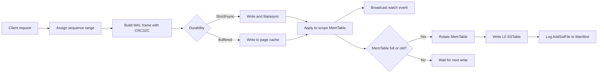
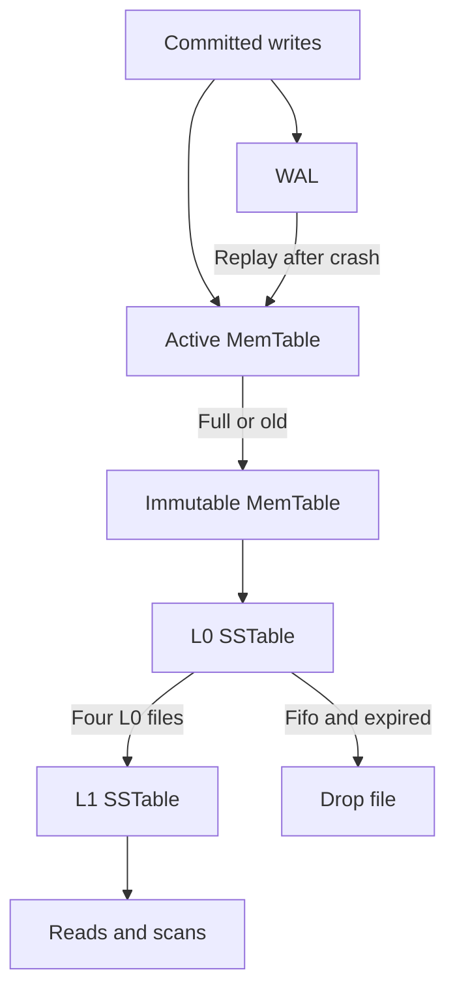

# Architecture

StorKV is a log-structured merge-tree engine. It writes changes to a shared write-ahead log, buffers them in scope memtables, flushes immutable memtables to SSTables, and merges SSTables during compaction.

## Main components

| Component      | Scope     | Purpose                                             |
| :------------- | :-------- | :-------------------------------------------------- |
| Request frame  | Global    | One `STORKPRT` v1 message per client operation      |
| WAL            | Global    | Durable ordered log of committed batches            |
| MemTable       | Per scope | In-memory sorted write buffer                       |
| Flush queue    | Per scope | Immutable memtables that wait for an SSTable write  |
| SSTable        | Per scope | Immutable sorted file with prefix-compressed blocks |
| Manifest       | Global    | Version log for scopes, SSTables, and snapshots     |
| Compactor      | Per scope | Leveled merge or FIFO expiry drop                   |
| Watch registry | Global    | Broadcast channel for committed change events       |

Every scope shares one WAL. Each scope owns its memtable, flush queue, and SSTable levels.

## Write path

The write path has these stages:

1. The client sends a put, delete, merge, range delete, or transaction commit.
2. The engine assigns one contiguous sequence range to the batch.
3. The engine builds one WAL frame with a CRC32C checksum.
4. The WAL writer appends the frame and applies the durability rule.
5. The commit applies each mutation to the scope memtable.
6. The commit broadcasts change events to watch subscribers.

The WAL append and the memtable apply happen under one commit lock. A reader never sees a committed write before the memtable holds it.

### Durability choices

| Mode                         | Commit waits for       | Data loss window                      |
| :--------------------------- | :--------------------- | :------------------------------------ |
| `StrictFsync`                | `fdatasync` on the WAL | None after the commit returns         |
| `Buffered { sync_interval }` | A page-cache write     | Up to the sync interval on power loss |

A batch that touches several scopes uses the strictest mode of every touched scope. One strict scope makes the whole batch strict.

### MemTable flush

A commit checks the active memtable after it applies the write. The engine flushes the memtable when either limit is reached:

- The memtable size is at least `max_wal_pin_bytes`. The default is 64 MiB.
- The memtable age is at least `max_wal_pin_age`. The default is 60 seconds.

The flush rotates the memtable, writes one L0 SSTable, and logs the file in the manifest. The SSTable uses LZ4 block compression.

## Read path

A point read has these stages:

1. The request resolves the scope name to a scope ID.
2. The engine checks the active memtable and the flush queue.
3. The engine checks each SSTable level from L0 to L6.
4. The engine keeps the newest version at or below the read sequence.
5. The engine drops expired keys and deleted keys.
6. The engine returns the value or a not-found result.

A scan collects entries from the SSTables and memtables, keeps the newest visible version of each key, and yields keys in bytewise order.

### Key order

StorKV compares user keys as raw bytes. The order is bytewise lexicographical order, not locale order and not UTF-8 code point order.

The internal key adds an inverted sequence tag. This tag places the newest version of a user key first inside the memtable and inside SSTable blocks.

### Scan bounds

- `start` is inclusive.
- `end` is exclusive.
- A prefix scan starts at the prefix bytes and keeps keys that start with the prefix.
- A transaction scan uses the transaction read sequence.

## Compaction

StorKV has two compaction styles.

| Style     | Trigger                                      | Action                               |
| :-------- | :------------------------------------------- | :----------------------------------- |
| `Leveled` | `l0_compaction_trigger` L0 files (default 4) | Merge all L0 files into one L1 file  |
| `Fifo`    | An SSTable is fully expired                  | Drop the file without rewriting keys |

Compaction runs when a caller invokes `Db::compact`, `Db::compact_range`, `POST /v1/admin/compact`, or the gRPC `Compact` method. The engine can also run compaction on a background thread. Set `DbOptions::enable_background_compaction` to `true` to start it. The scheduler waits for a MemTable flush and compacts the scopes that reached the L0 trigger. Read [Compaction and tuning](../operations/compaction-and-tuning.md).

Compaction keeps versions that a reader or a pinned snapshot can still need. The safe sequence is the minimum of these values:

- The oldest active transaction read sequence.
- The oldest pinned snapshot sequence.
- The current visible sequence.

An expired or deleted version below that floor can be removed.

## Crash recovery

On open, the engine takes these steps:

1. It locks the data directory with `<db_root>/LOCK`.
2. It opens `CURRENT` and the active manifest.
3. It loads scope metadata and SSTable lists.
4. It replays WAL segments from `min_unflushed_wal_num`.
5. It verifies the CRC32C checksum of every frame.
6. It truncates a torn final frame and starts cleanly.

A corrupted frame in the middle of a segment stops startup with a corruption error. The engine does not skip such a frame.

## Related guides

- [Scopes](scopes.md)
- [MVCC and transactions](mvcc-and-transactions.md)
- [Compaction and tuning](../operations/compaction-and-tuning.md)
- On-disk format: `FORMAT.md`
