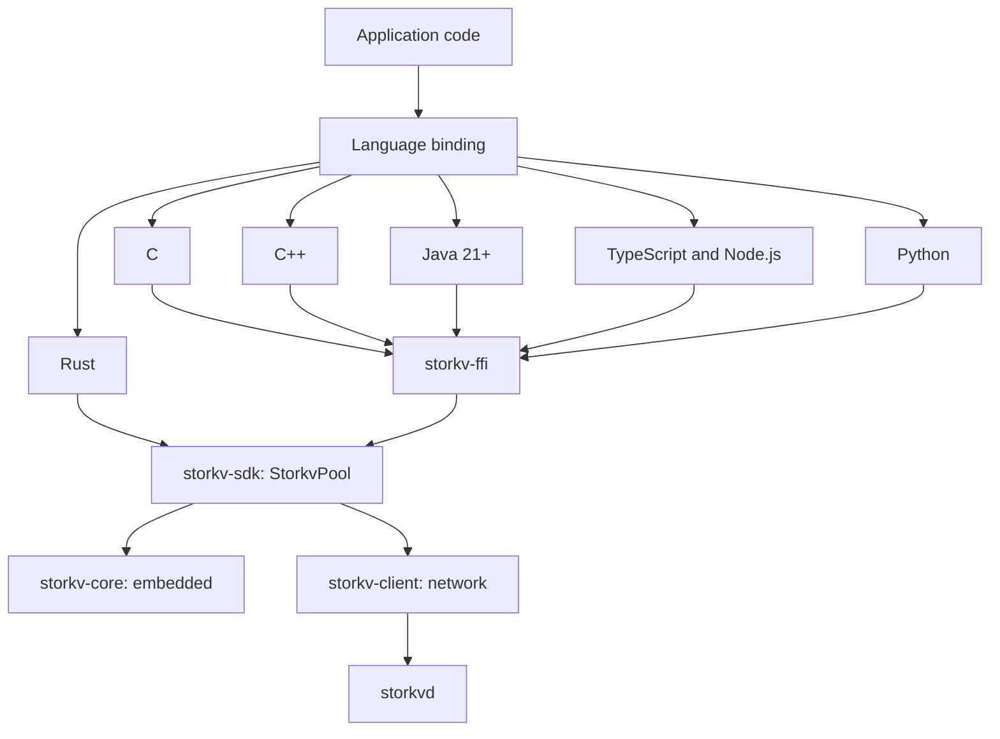

# StorKV SDK

The `storkv-sdk` crate gives one pooled API for local storage and remote servers. The `storkv-ffi` crate exposes that API through the C ABI. The C ABI is the bridge for C, C++, Java, TypeScript, and Python.

## One API for both modes

`StorkvPool` parses the connection URI and selects the backend.

- A `file://` or `embedded://` URI opens `storkv-core` in the current process.
- A `storkv://`, `grpc://`, `http://`, `https://`, `ws://`, `wss://`, or `unix://` URI opens pooled `storkv-client` connections.
- A bare `host:port` value selects the native transport.

Application code uses the same methods in both modes. A change from an embedded directory to a remote server changes one URI. Read [Connection URIs](../getting-started/connection-uris.md) for each scheme.

The pool keeps a connection limit, an acquire timeout, an idle timeout, and an optional health probe. A networked pool also retries the first connection three times. The pool returns idle clients to a shared list after use.

## Architecture

The `storkv-ffi` layer owns one multithreaded Tokio runtime for each pool. Foreign callers never create or poll Rust futures. Each C function blocks until the operation completes. This design keeps every binding small and consistent.

## Choose a language

| Language | Binding mechanism | Memory model | Minimum version | Guide |
| :--- | :--- | :--- | :--- | :--- |
| Rust | Native crate `storkv-sdk` | Rust ownership and `Drop` | Rust 1.87 | [Rust](rust.md) |
| C | C ABI through `bindings/c/storkv.h` | Manual free calls | C99 | [C](c.md) |
| C++ | Header-only RAII in `bindings/cpp/storkv.hpp` | Move-only objects and `std::vector` | C++20 | [C++](cpp.md) |
| Java | Foreign Function and Memory API | `AutoCloseable` and `Arena` | Java 21 | [Java](java.md) |
| TypeScript | koffi dynamic calls | `Uint8Array` and `close()` | Node.js 22 | [TypeScript](typescript.md) |
| Python | `ctypes` module | Context managers and `bytes` | Python 3.9 | [Python](python.md) |

The Rust path has no FFI boundary. A Rust application uses `StorkvPool` directly. The other languages call the same C functions. Read the [C ABI reference](../reference/ffi-c-abi.md) for exact struct layouts and function signatures.

## Handle life cycle

Every language follows the same order:

1. Open a pool.
2. Open a scope handle.
3. Read, write, scan, transact, and watch.
4. Close watch handles and transaction handles.
5. Close the scope handle.
6. Close the pool.

> [!IMPORTANT]
> Close a watch handle and a transaction handle before you close the scope that they use. Close every scope handle before you close its pool. A call on a closed handle returns an error status. It does not crash the process.

> [!WARNING]
> A returned `StorkvBytes`, `StorkvEntries`, or `StorkvString` buffer belongs to the caller after the call. Release each buffer exactly once. Use `storkv_bytes_free`, `storkv_entries_free`, or `storkv_string_free`. Do not release a buffer with `free` or `delete`.

## Memory ownership

The C ABI uses two buffer classes:

| Buffer class | Owner before the call | Owner after the call | Release rule |
| :--- | :--- | :--- | :--- |
| `StorkvSlice` | Caller | Caller | Keep the bytes alive during the call only |
| `StorkvBytes` | Library | Caller | Call `storkv_bytes_free` after use |
| `StorkvEntries` | Library | Caller | Call `storkv_entries_free` after use |
| `StorkvString` | Library | Caller | Call `storkv_string_free` after use |

An input slice is a borrowed pointer and a length. The library copies input bytes before the call returns. You can release or change the input buffer after the call.

An output buffer is a heap allocation from Rust. The pointer is valid until you free it. A null pointer with a zero length means an empty value.

## Error model

Every data function returns a `StorkvStatus` value. A zero value means success. A non-zero value means failure.

Call `storkv_last_error_message` after a failure. The function returns the message for the calling thread. Release the message with `storkv_string_free`.

| Status | Value | Typical cause |
| :--- | :--- | :--- |
| `Ok` | 0 | Success |
| `NullPointer` | 1 | A required pointer is null |
| `InvalidArgument` | 2 | The caller supplied a malformed URI, option, or argument |
| `Pool` | 3 | The pool cannot open or is closed |
| `Scope` | 4 | The scope does not resolve |
| `Transaction` | 5 | The transaction cannot start or commit |
| `Serialization` | 6 | A value cannot encode or decode |
| `Watch` | 7 | The watch stream ended or failed |
| `Timeout` | 8 | The operation exceeded its deadline |
| `Internal` | 9 | Another internal failure |

Read [Error codes](../reference/error-codes.md) for the server-side wire codes.

## Thread safety

A pool handle can serve more than one thread. The pool controls concurrent access with a semaphore. Each checked-out connection returns to the pool when it is released.

Do not use one transaction handle or one watch handle from two threads at the same time. Each handle holds mutable state. Wrap the handle in your own lock when you need shared access.

The FFI layer records the last error message in thread-local storage. A thread must read its own error message. Do not read the message from another thread.

## Start here

- [Rust guide](rust.md): use `StorkvPool` directly.
- [C guide](c.md): call the C ABI and free every output buffer.
- [C++ guide](cpp.md): use move-only RAII wrappers.
- [Java guide](java.md): use the Foreign Function and Memory API.
- [TypeScript guide](typescript.md): use koffi from Node.js.
- [Python guide](python.md): use `ctypes` context managers.
- [C ABI reference](../reference/ffi-c-abi.md): inspect layouts, status codes, and every function.
